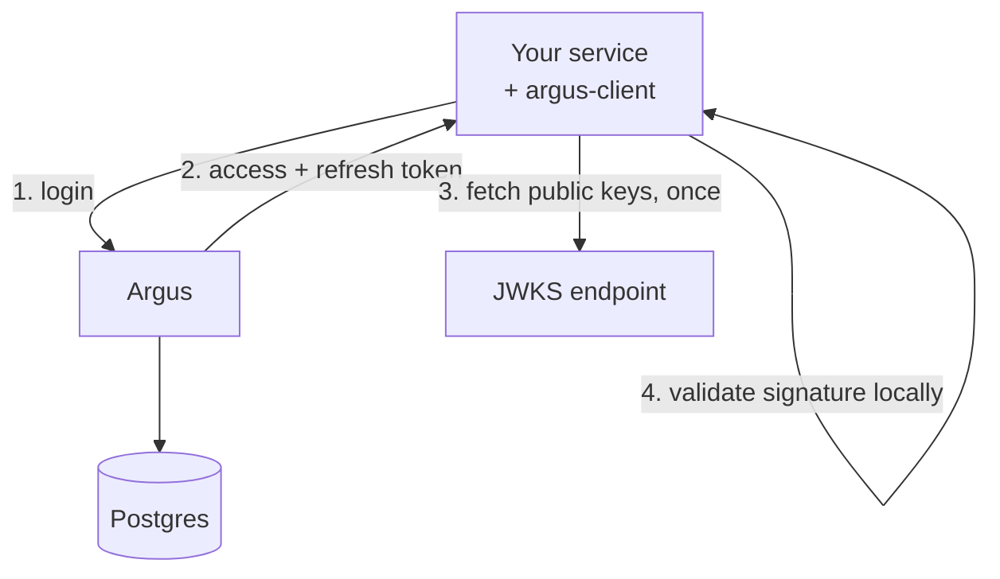
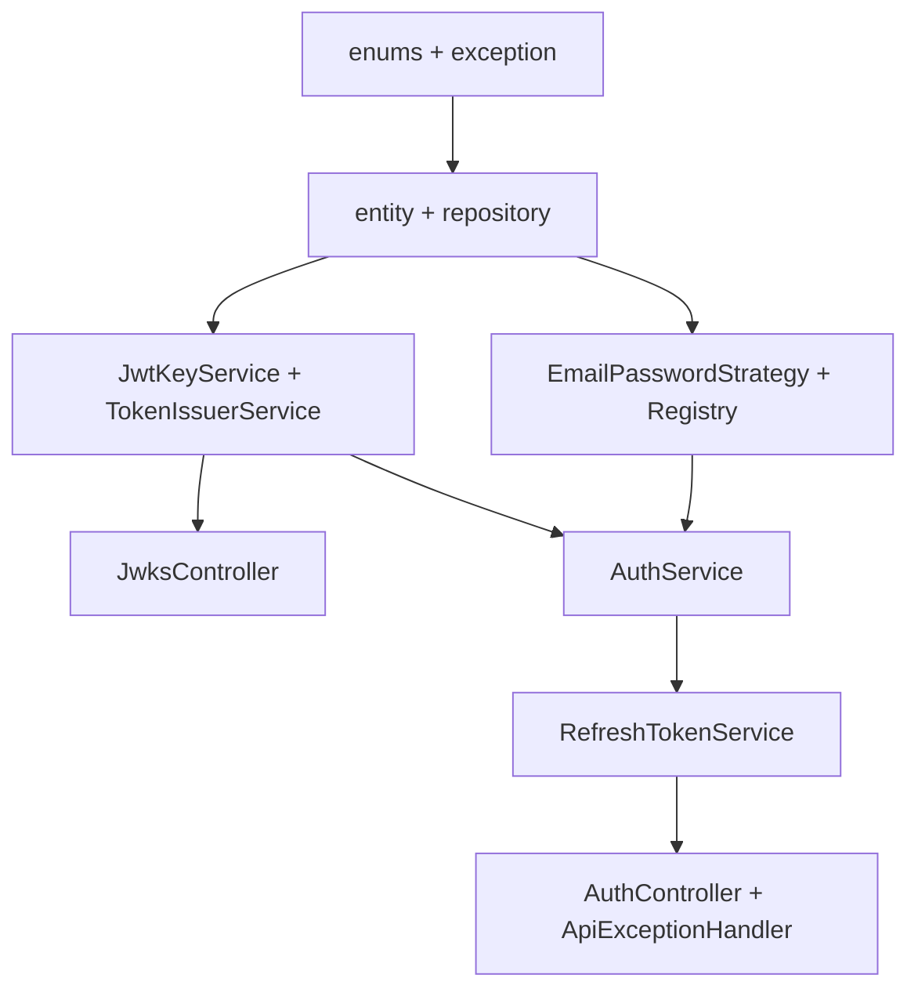

# Argus

A self-hostable authentication service, plus a Spring Boot client you drop into any service that needs to know who the caller is.

Argus issues and rotates tokens. Everything else validates them **locally** — no network call to Argus on the request path.

> **Status: early.** The skeleton builds and the Flyway schema is in place. The service code is being written by hand, class by class — see [Build reference](#build-reference) for the order and what each class owes.

---

## Why

Every side project ends up rewriting the same login, the same refresh endpoint, the same `@PreAuthorize`. Argus is that written once: run one instance, add one dependency to every other service.

---

## How it works



Argus signs access tokens with an RSA private key and publishes the matching public key at `/.well-known/jwks.json`. The client fetches those keys once and caches them, then verifies every incoming token itself.

That means Argus is only touched at login and refresh. It can be down and your services keep authenticating requests.

The trade-off: a revoked access token stays valid until it expires. Mitigated by a 15-minute access-token TTL and immediate refresh-token revocation — the same bargain Auth0 and Cognito make.

---

## Modules

| Module | Published | Purpose |
|---|---|---|
| `argus-server` | no | The service. Issues tokens, owns the user store. |
| `argus-client` | yes | DTOs + Spring Boot auto-configuration. The only thing other services import. |

`argus-server` is explicitly excluded from `mvn deploy` — if a consumer could import server internals, the boundary would already be broken.

---

## Tokens

**Access token** — JWT, RS256, 15 minutes.

```
iss  argus
sub  <userId>
aud  <client-id>
exp  iat  jti
roles        ["ADMIN"]
permissions  ["user:read", "user:write"]
```

The header carries a `kid` so signing keys can be rotated without invalidating every live token.

**Refresh token** — opaque 256-bit random value, 30 days. The client holds the plaintext; Argus stores only a SHA-256 hash, the same way it stores passwords. A database leak yields nothing usable.

**Rotation with reuse detection** — every refresh issues a new token and marks the old one used, within a token *family*. If an already-used token is presented again, the entire family is revoked and the user must log in again. That replay is the signature of a stolen token, and it's the piece most hand-rolled auth services skip.

---

## Using it from another service

> Not published yet — this is the intended shape.

```xml
<dependency>
    <groupId>com.rcadium</groupId>
    <artifactId>argus-client</artifactId>
    <version>${argus.version}</version>
</dependency>
```

```yaml
argus:
  client:
    issuer-uri: https://argus.example.com
    audience: my-app
```

That's the whole setup. The starter contributes a `JwtDecoder`, maps the `roles` and `permissions` claims to Spring authorities, and installs a resource-server filter chain — so this just works:

```java
@GetMapping("/admin/reports")
@PreAuthorize("hasRole('ADMIN')")
public List<Report> reports() { ... }
```

Every bean is `@ConditionalOnMissingBean`, so declaring your own overrides it.

---

## API

| Method | Path | |
|---|---|---|
| `POST` | `/api/v1/auth/register` | email + password |
| `POST` | `/api/v1/auth/login` | returns access + refresh |
| `POST` | `/api/v1/auth/refresh` | rotates the refresh token |
| `POST` | `/api/v1/auth/logout` | revokes the token family |
| `GET` | `/api/v1/users/me` | authenticated |
| `GET` | `/api/v1/admin/users` | `ADMIN` |
| `PUT` | `/api/v1/admin/users/{id}/roles` | `ADMIN` |
| `GET` | `/.well-known/jwks.json` | public |

Errors share one shape: `{ code, message, traceId, timestamp }`. Login failures return a single generic code — never "no such user" versus "wrong password", which would turn the endpoint into a user-enumeration oracle.

---

## Design

Flat Spring MVC: `controller → service → repository`. There is no port/adapter layer and no separate domain model — JPA entities *are* the model, and services talk to Spring Data repositories directly. The earlier hexagonal version of this service is in history at `b08ee41`; it was dropped because a mapper and a port interface per repository bought nothing at this size and made the auth flow hard to read end to end.

```
com.rcadium.argus
├── ArgusServerApplication.java
├── config/            ClockConfiguration, TokenProperties, SecurityConfig, JwtKeyConfiguration
├── controller/        AuthController, UserController, AdminUserController, JwksController, ApiExceptionHandler
├── dto/               LoginRequest, RegisterRequest, RefreshRequest, TokenResponse, ErrorResponse
├── enums/             AuthMethod, UserStatus, ErrorCode
├── exception/         ArgusException + one subclass per failure mode
├── entity/            UserEntity, RoleEntity, PermissionEntity, RefreshTokenEntity, AuthIdentityEntity
├── repository/        UserJpaRepository, RoleJpaRepository, RefreshTokenJpaRepository, AuthIdentityJpaRepository
├── service/
│   ├── AuthService.java              resolve strategy → authenticate → issue token pair
│   ├── RefreshTokenService.java      rotation, reuse detection, family revocation
│   ├── TokenIssuerService.java       builds and signs the access-token JWT
│   ├── JwtKeyService.java            active signing key + the JWKS view of all valid keys
│   └── auth/
│       ├── AuthenticationStrategy.java          interface — one per login method
│       ├── AuthenticationStrategyRegistry.java  Map<AuthMethod, Strategy>, built from List<Strategy>
│       ├── AuthCredentials.java                 sealed marker for strategy input
│       └── strategy/
│           └── EmailPasswordAuthenticationStrategy.java
└── util/
```

The registry is keyed lookup, not an `if`-chain, so each authentication method is self-contained. The design constraint, which is really the point of the project:

> Adding Google login should add files and change none.

If a new provider forces an edit to `AuthService` or a controller, the extension point was in the wrong place. Production concerns arrive later as plain services in the same `service/` package — `LoginAttemptService` (lockout and rate limiting), `AuditService`, `SessionService` (device-scoped refresh families) — never as new layers.

---

## Build reference

Written by hand in this order; each step compiles and is testable before the next one starts.



| # | Class | What it owes |
|---|---|---|
| 1 | `enums/AuthMethod`, `UserStatus`, `ErrorCode` | `EMAIL_PASSWORD` to start; `ACTIVE`/`DISABLED`; one error code per client-visible failure |
| 2 | `exception/ArgusException` + subclasses | `InvalidCredentials`, `EmailAlreadyRegistered`, `AccountNotActive`, `InvalidRefreshToken` — each carries an `ErrorCode` |
| 3 | `entity/*` | Mirrors V1 exactly: `users`, `roles`, `permissions`, `user_roles`, `role_permissions`, `refresh_tokens`, `auth_identities`. UUID ids, `timestamptz` → `OffsetDateTime` |
| 4 | `repository/*` | `findByEmailIgnoreCase`, `findByTokenHash`, bulk `revokeFamily(familyId)` |
| 5 | `config/TokenProperties` | `@ConfigurationProperties("argus.token")` — issuer, audience, access TTL (15m), refresh TTL (30d) |
| 6 | `service/JwtKeyService` | RSA keypair from PEM config, generated fallback for local dev, stable `kid`, exposes the public JWK set |
| 7 | `service/TokenIssuerService` | RS256 JWT with `iss sub aud exp iat jti roles permissions` and `kid` in the header |
| 8 | `controller/JwksController` | `GET /.well-known/jwks.json`, public, no auth |
| 9 | `service/auth/*` | Strategy interface returns a `UserEntity`; BCrypt verify in the email/password impl; registry fails loudly on an unknown `AuthMethod` |
| 10 | `service/AuthService` | register (reject duplicate email, assign `USER` role) and login (strategy → status check → token pair) |
| 11 | `service/RefreshTokenService` | store SHA-256 hash only; on refresh, rotate and mark used; a reused token revokes the whole family |
| 12 | `controller/AuthController` + `ApiExceptionHandler` | the four auth endpoints; one error shape, one generic code for every login failure |
| 13 | `config/SecurityConfig` | stateless, CSRF off, `/api/v1/auth/**` and `/.well-known/**` public, everything else authenticated |

Things that must stay true as it grows:

- Login failures never distinguish "no such user" from "wrong password" — that is a user-enumeration oracle.
- Refresh tokens are only ever persisted as a SHA-256 hash. Same for passwords, via BCrypt.
- Every write path is idempotent or guarded by a unique constraint; refresh is the one non-idempotent call, and reuse detection is what makes a retried refresh safe to reason about.
- `service/` never imports from `controller/`, and no `dto/` type is accepted by or returned from a service — map at the controller edge.

---

## Running locally

Requires JDK 21. Postgres is hosted on [Neon](https://neon.tech) — point the app at your branch's connection string:

```bash
export ARGUS_DB_URL="jdbc:postgresql://<host>.neon.tech/argus?sslmode=require"
export ARGUS_DB_USER="..."
export ARGUS_DB_PASSWORD="..."

./mvnw spring-boot:run -pl argus-server
```

Tests don't touch Neon — they spin up a throwaway Postgres via Testcontainers, so they need Docker running but no network or credentials:

```bash
./mvnw clean install
```

Keeping the two separate matters: tests that share a real database are order-dependent and fail in CI for reasons that have nothing to do with the code.

---

## Roadmap

- [x] Multi-module skeleton
- [x] Flyway schema — users, roles, permissions, refresh tokens, auth identities
- [ ] Entities and repositories
- [ ] RSA key management, JWT issuing, JWKS endpoint
- [ ] Email + password registration and login
- [ ] Refresh rotation with reuse detection
- [ ] Roles, permissions, admin endpoints
- [ ] `argus-client` auto-configuration
- [ ] Publish to GitHub Packages
- [ ] Google · GitHub · mobile OTP — each additive
