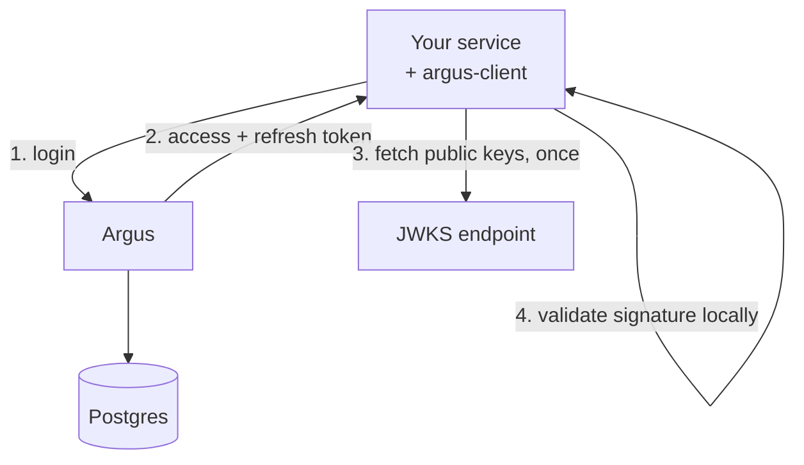

# Argus

A self-hostable authentication service, plus a Spring Boot client you drop into any service that needs to know who the caller is.

Argus issues and rotates tokens. Everything else validates them **locally** — no network call to Argus on the request path.

> **Status: early.** The multi-module skeleton builds. None of the auth logic is implemented yet. See [Roadmap](#roadmap).

---

## Why

Every side project ends up rewriting the same login, the same refresh endpoint, the same `@PreAuthorize`. Argus is that written once: run one instance, add one dependency to every other service.

---

## How it works



Argus signs access tokens with an RSA private key and publishes the matching public key at `/.well-known/jwks.json`. The client fetches those keys once and caches them, then verifies every incoming token itself.

That means Argus is only touched at login and refresh. It can be down and your services keep authenticating requests.

The trade-off: a revoked access token stays valid until it expires. Mitigated by a 15-minute access-token TTL and immediate refresh-token revocation — the same bargain Auth0 and Cognito make.

---

## Modules

| Module | Published | Purpose |
|---|---|---|
| `argus-server` | no | The service. Issues tokens, owns the user store. |
| `argus-client` | yes | DTOs + Spring Boot auto-configuration. The only thing other services import. |

`argus-server` is explicitly excluded from `mvn deploy` — if a consumer could import server internals, the boundary would already be broken.

---

## Tokens

**Access token** — JWT, RS256, 15 minutes.

```
iss  argus
sub  <userId>
aud  <client-id>
exp  iat  jti
roles        ["ADMIN"]
permissions  ["user:read", "user:write"]
```

The header carries a `kid` so signing keys can be rotated without invalidating every live token.

**Refresh token** — opaque 256-bit random value, 30 days. The client holds the plaintext; Argus stores only a SHA-256 hash, the same way it stores passwords. A database leak yields nothing usable.

**Rotation with reuse detection** — every refresh issues a new token and marks the old one used, within a token *family*. If an already-used token is presented again, the entire family is revoked and the user must log in again. That replay is the signature of a stolen token, and it's the piece most hand-rolled auth services skip.

---

## Using it from another service

> Not published yet — this is the intended shape.

```xml
<dependency>
    <groupId>com.rcadium</groupId>
    <artifactId>argus-client</artifactId>
    <version>${argus.version}</version>
</dependency>
```

```yaml
argus:
  client:
    issuer-uri: https://argus.example.com
    audience: my-app
```

That's the whole setup. The starter contributes a `JwtDecoder`, maps the `roles` and `permissions` claims to Spring authorities, and installs a resource-server filter chain — so this just works:

```java
@GetMapping("/admin/reports")
@PreAuthorize("hasRole('ADMIN')")
public List<Report> reports() { ... }
```

Every bean is `@ConditionalOnMissingBean`, so declaring your own overrides it.

---

## API

| Method | Path | |
|---|---|---|
| `POST` | `/api/v1/auth/register` | email + password |
| `POST` | `/api/v1/auth/login` | returns access + refresh |
| `POST` | `/api/v1/auth/refresh` | rotates the refresh token |
| `POST` | `/api/v1/auth/logout` | revokes the token family |
| `GET` | `/api/v1/users/me` | authenticated |
| `GET` | `/api/v1/admin/users` | `ADMIN` |
| `PUT` | `/api/v1/admin/users/{id}/roles` | `ADMIN` |
| `GET` | `/.well-known/jwks.json` | public |

Errors share one shape: `{ code, message, traceId, timestamp }`. Login failures return a single generic code — never "no such user" versus "wrong password", which would turn the endpoint into a user-enumeration oracle.

---

## Design

The server is layered, and the dependency arrow only points inward:

```
web  →  application  →  domain
```

```
com.rcadium.argus
├── domain/          entities + repository interfaces. No Spring, no JPA.
│   └── port/
├── application/     AuthService, strategies, token services
└── infrastructure/
    ├── persistence/ JPA entities + adapters implementing the domain ports
    ├── security/    filter chain, key management
    └── web/         controllers, exception handling
```

`domain` imports nothing from the layers above it. If a domain class ever needs a Spring context to be unit-tested, that rule has been broken.

Each authentication method is an `AuthenticationStrategy` resolved from a registry at runtime. The design constraint, which is really the point of the project:

> Adding Google login should add files and change none.

If a new provider forces an edit to `AuthService` or a controller, the extension point was in the wrong place.

---

## Running locally

Requires JDK 21. Postgres is hosted on [Neon](https://neon.tech) — point the app at your branch's connection string:

```bash
export ARGUS_DB_URL="jdbc:postgresql://<host>.neon.tech/argus?sslmode=require"
export ARGUS_DB_USER="..."
export ARGUS_DB_PASSWORD="..."

./mvnw spring-boot:run -pl argus-server
```

Tests don't touch Neon — they spin up a throwaway Postgres via Testcontainers, so they need Docker running but no network or credentials:

```bash
./mvnw clean install
```

Keeping the two separate matters: tests that share a real database are order-dependent and fail in CI for reasons that have nothing to do with the code.

---

## Roadmap

- [x] Multi-module skeleton
- [ ] Domain model and repository ports
- [ ] Persistence — Flyway schema, JPA adapters
- [ ] RSA key management, JWT issuing, JWKS endpoint
- [ ] Email + password registration and login
- [ ] Refresh rotation with reuse detection
- [ ] Roles, permissions, admin endpoints
- [ ] `argus-client` auto-configuration
- [ ] Publish to GitHub Packages
- [ ] Google · GitHub · mobile OTP — each additive
